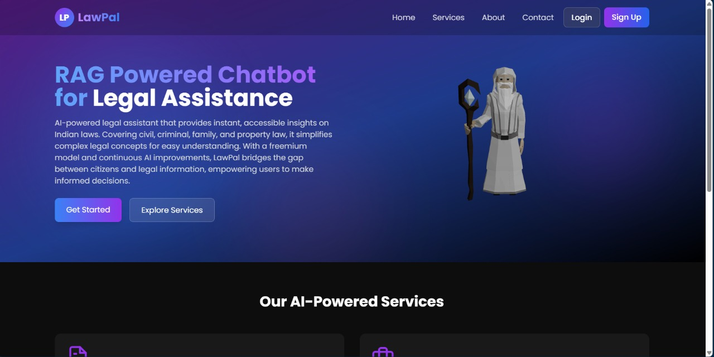
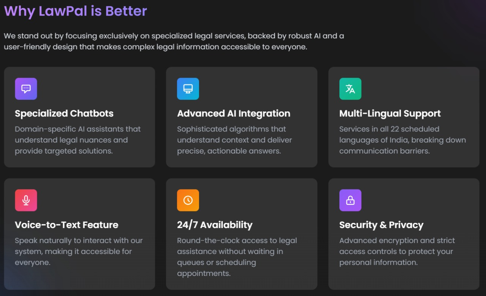
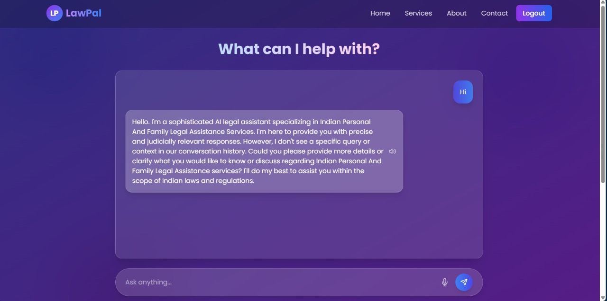

# **LawPal: AI-Powered Legal Assistance Chatbot**

## **Overview**
**LawPal** is an AI-driven chatbot designed to assist users with legal inquiries and to check the judgments given in court cases. It simplifies legal research and provides real-time guidance by leveraging **Pinecone** for vector search, **Groq** for natural language processing, and **Flask** for backend services.

---

## **Features**
- **Legal Chatbot**: Get instant answers to legal questions.
- **Legal Document Search**: Answers draw on indexed Indian legal documents, current to 2024.
- **Live Judgment Checks**: Ask the chatbot about the judgment in a specific case, by CNR or party names, using [eCourtsIndia](https://ecourtsindia.com/).
- **Voice-to-Text & Text-to-Speech**: Interact using voice commands and listen to responses.
- **Multi-Language Support**: Available in multiple languages for accessibility.

---

## **Technologies Used**
- **Frontend**: Vite, React, Tailwind CSS
- **Backend**: Flask, Pinecone, Groq
- **Court Data**: eCourtsIndia partner API
- **Authentication**: Supabase Authentication
- **Voice Recognition**: Web Speech API
- **Text-to-Speech**: Web Speech API
- **Routing**: React Router
- **State Management**: React Hooks

---

## **Setup Instructions**

### **1. Clone the Repository**
```bash
git clone https://github.com/AaryanGole26/LawPal.git
cd LawPal
```

### **2. Backend Setup**
- Install Python dependencies from the project root:
  ```bash
  pip install -r Server/requirements.txt
  ```
- Set up environment variables:
  Copy `.env.example` to `.env` in the project root and fill it in:
  ```env
  PINECONE_API=your_pinecone_api_key
  PINECONE_ENV=your_pinecone_environment
  GROQ_API=your_groq_api_key
  SUPABASE_URL=your_supabase_url
  SUPABASE_ANON_KEY=your_supabase_anon_key
  ECOURTS_API_KEY=your_ecourts_api_key
  ```
- Run the Flask server:
  ```bash
  cd Server
  python app.py
  ```
  The backend will run on `http://127.0.0.1:5050` (set `PORT` to change it; Windows often reserves 5000). `GET /health` shows which services are configured.
- To deploy, use `Server/Dockerfile` (build from the project root) or `Server/Procfile`. Keep to one worker: chat history and rate limits are held in memory per process.
- Set `CREATE_PINECONE_INDEX=true` to index the PDFs in the Supabase `pdfs` bucket on startup. An index that already has vectors is left as it is.
- Set `CORS_ORIGINS` if the frontend runs anywhere other than the default origins.
- Groq's free tier allows 8,000 tokens per minute across all users, which sustains only about two chat messages a minute. Use a paid tier for real traffic.
- Run the backend tests:
  ```bash
  pip install -r Server/requirements-dev.txt
  cd Server
  python -m pytest tests
  ```

### **3. Frontend Setup**
- Navigate to the frontend folder:
  ```bash
  cd App/project
  ```
- Install Node.js dependencies:
  ```bash
  npm install
  ```
- Start the development server:
  ```bash
  npm run dev
  ```
  The frontend will run on `http://localhost:5173`.

### **4. Supabase Authentication**
- Set up a Supabase project at [Supabase Console](https://supabase.io/).
- Copy `App/project/.env.example` to `App/project/.env` and add your Supabase URL, anon key and deployed backend URL. During `npm run dev`, `.env.development` points the app at the local backend.
- Run `Server/schema.sql` in the Supabase SQL editor to create the tables and access policies.
- Enable **Email/Password** authentication in Supabase settings, and set the Site URL to a live deployment. Password reset emails link there, and the app then opens the reset page.

### **5. Live Judgment Checks (eCourts)**
The RAG documents are current to 2024. When a signed-in user asks about the judgment in a specific case, the chatbot checks [eCourtsIndia](https://ecourtsindia.com/) and answers from the live record.

- Create a key at the [eCourtsIndia dashboard](https://ecourtsindia.com/dashboard/api/keys) and set `ECOURTS_API_KEY` in the root `.env`. It stays on the server. Never give it a `VITE_` prefix.
- eCourts bills per request, so spending is limited:
  - A small model first decides if the message needs a lookup. General legal questions never trigger one, and guests never spend credits.
  - A named case costs at most Rs 2.10: one search (Rs 0.60), then case detail (Rs 1.50) only if both parties match. A message with a CNR costs Rs 1.50. Other billed endpoints are not used.
  - Answers give the outcome, dates and judges. The record usually has no judgment text, so the chatbot says when it could not read the reasoning.
  - Results are cached in `Server/.ecourts_cache.sqlite3` (`ECOURTS_STORE_PATH` to move it): decided cases for 90 days, searches for 7 days, pending cases for 1 day. Keep this file on persistent storage, because a redeploy that loses it also resets the daily caps.
  - Daily caps default to Rs 10 per user (`ECOURTS_USER_DAILY_BUDGET_INR`) and Rs 50 overall (`ECOURTS_DAILY_BUDGET_INR`). Once reached, the chatbot says it could not check live records.
- Check the integration against the live API (this spends up to Rs 2.10):
  ```bash
  cd Server
  python ecourts_smoke_test.py
  ```

---

## **Usage**
### **1. Access the Platform**
- Open your browser and go to `http://localhost:5173`.
- Chat works without an account. Log in to check judgments against live court records.

### **2. Interact with the Chatbot**
- Type or speak legal queries to get AI-powered responses.
- Ask about a specific case by CNR or party names to check its judgment. Answers show the outcome, dates and judges, with a link to the case.

---

## **Screenshots**


*Caption: LawPal Homepage*


*Caption: Available Legal Services*


*Caption: Chatbot in Action*

---

## **Acknowledgments**
- **Pinecone** for vector search capabilities.
- **Groq** for NLP-powered legal analysis.
- **Flask & Vite-React** for building the backend and frontend.
- **Supabase** for authentication and database management.

